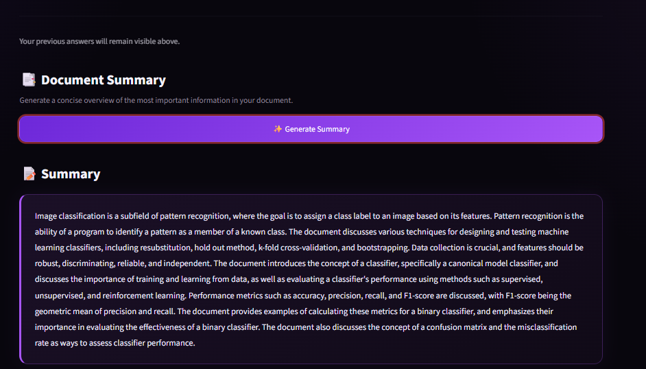

# AI Document Intelligence System

A Retrieval-Augmented Generation (RAG) PDF assistant built with Streamlit, Mistral 7B Instruct, LangChain, multilingual sentence embeddings, and FAISS.

> Developed as a project during the Tips Hindawi Internship (August–October 2026), Large Language Models (LLMs) Program, with Edrak for AI.

## Participant

| Field | Value |
|---|---|
| Full Name | Basma Maher Fathi |
| Project Name | AI Document Intelligence System |
| GitHub Username | [BasmaMaher11](https://github.com/BasmaMaher11) |
| Internship Batch | August–October 2026 |
| Training Program | Large Language Models (LLMs) Program |
| Organization | [Edrak for AI](https://edrak4ai.com/en) |

## Project Overview

AI Document Intelligence System lets users upload a PDF, ask questions about its contents, and generate a concise document summary. It retrieves relevant text chunks from the uploaded document and uses the Mistral instruction model to generate answers grounded in that context. The app also displays the source page numbers associated with retrieved passages.

## Features

- Upload and process PDF documents.
- Split document text into overlapping chunks.
- Create multilingual text embeddings with `paraphrase-multilingual-MiniLM-L12-v2`.
- Store and search document vectors using FAISS.
- Ask questions and generate answers using Mistral 7B Instruct.
- Display source page numbers for retrieved context.
- Generate a summary from document chunks and combine partial summaries.
- Streamlit interface with question-and-answer history.

**Current implementation note:** the app provides a document summary; it does not currently display key points as a separate output section.

## Technologies Used

- Python
- Streamlit
- PyTorch
- Hugging Face Transformers
- `mistralai/Mistral-7B-Instruct-v0.2`
- LangChain
- PyPDF
- Sentence Transformers
- FAISS
- `bitsandbytes` for 4-bit model quantization

## Project Structure

```text
AI-Document-Intelligence/
├── app.py
├── requirements.txt
├── README.md
├── .gitignore
└── screenshots/
```

## Installation

### 1. Clone the repository

```bash
git clone https://github.com/BasmaMaher11/AI-Document-Intelligence.git
cd AI-Document-Intelligence
```

### 2. Create and activate a virtual environment

Windows:

```bash
python -m venv .venv
.venv\Scripts\activate
```

macOS/Linux:

```bash
python3 -m venv .venv
source .venv/bin/activate
```

### 3. Install dependencies

```bash
python -m pip install --upgrade pip
pip install -r requirements.txt
```

**Hardware and platform note:** the app loads Mistral 7B in 4-bit mode using `bitsandbytes` and `device_map="auto"`. A compatible GPU/CUDA setup is strongly recommended, and `bitsandbytes` support depends on the operating system and environment. The model and embedding weights must be downloaded on first use, so internet access is required. For the most reliable setup, use a compatible Linux/CUDA environment such as Kaggle.

### 4. Run the application

```bash
streamlit run app.py
```

Then open the local URL shown in the terminal (usually `http://localhost:8501`).

## Usage

1. Start the Streamlit application.
2. Upload a PDF file.
3. Wait for the document to be processed and indexed.
4. Enter a question about the PDF and select **Ask Question**.
5. Review the generated answer and source page numbers.
6. Select **Generate Summary** to summarize the document.

## Demo

Add screenshots of the running application to a `screenshots/` folder and embed them here, for example:

```md



```

Do not upload private or copyrighted PDFs without permission.

## Results

The application combines semantic retrieval with a generative language model to answer questions using relevant PDF passages. It also returns source page numbers based on the retrieved documents' metadata and generates a combined summary from batches of document chunks.

## Future Improvements

- Display key points as a separate output alongside the summary.
- Improve summary speed and add progress feedback for long documents.
- Add support for more file formats and document-level controls.
- Add automated tests and evaluate retrieval and answer quality.

## About the Internship

This project was developed as part of the [Tips Hindawi](https://www.tipshindawi.com/) Internship (August–October 2026), and it will be showcased on the official Tips Hindawi website.

[Tips Hindawi](https://www.tipshindawi.com/) is the internships department of [Edrak for AI](https://edrak4ai.com/en), and the internship encourages participants to build real-world projects, apply practical skills, and showcase their work through GitHub.

For more information about the internship, training programs, and upcoming batches, visit the official [Tips Hindawi](https://www.tipshindawi.com/) website.

## Security

- Never commit API keys, access tokens, passwords, `.env` files, private PDFs, model weights, or runtime logs.
- If a token was accidentally exposed, revoke it and create a new one before using the service again.
- Keep runtime credentials outside source code and out of Git history.

## License

This project is shared for educational and portfolio purposes.
